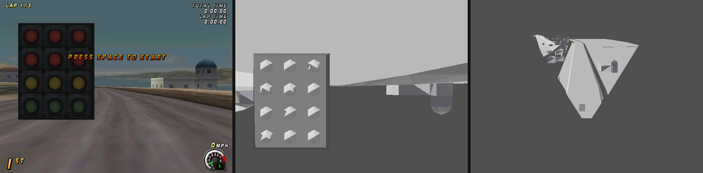
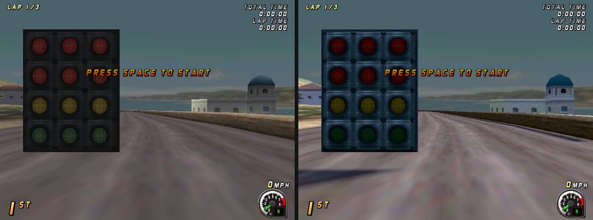
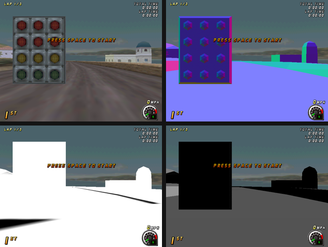
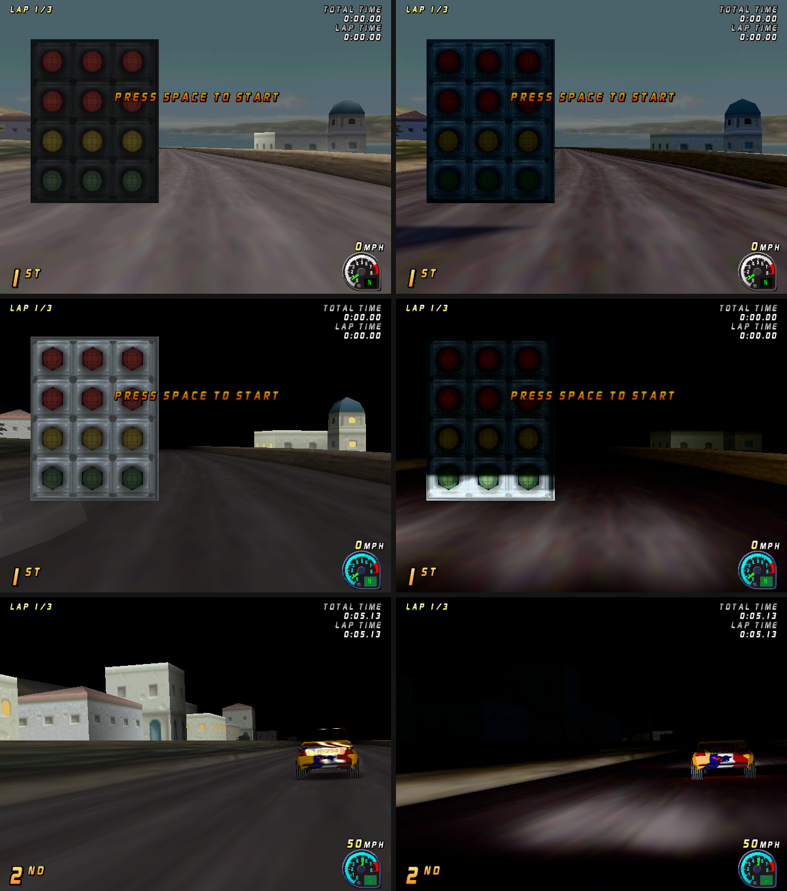
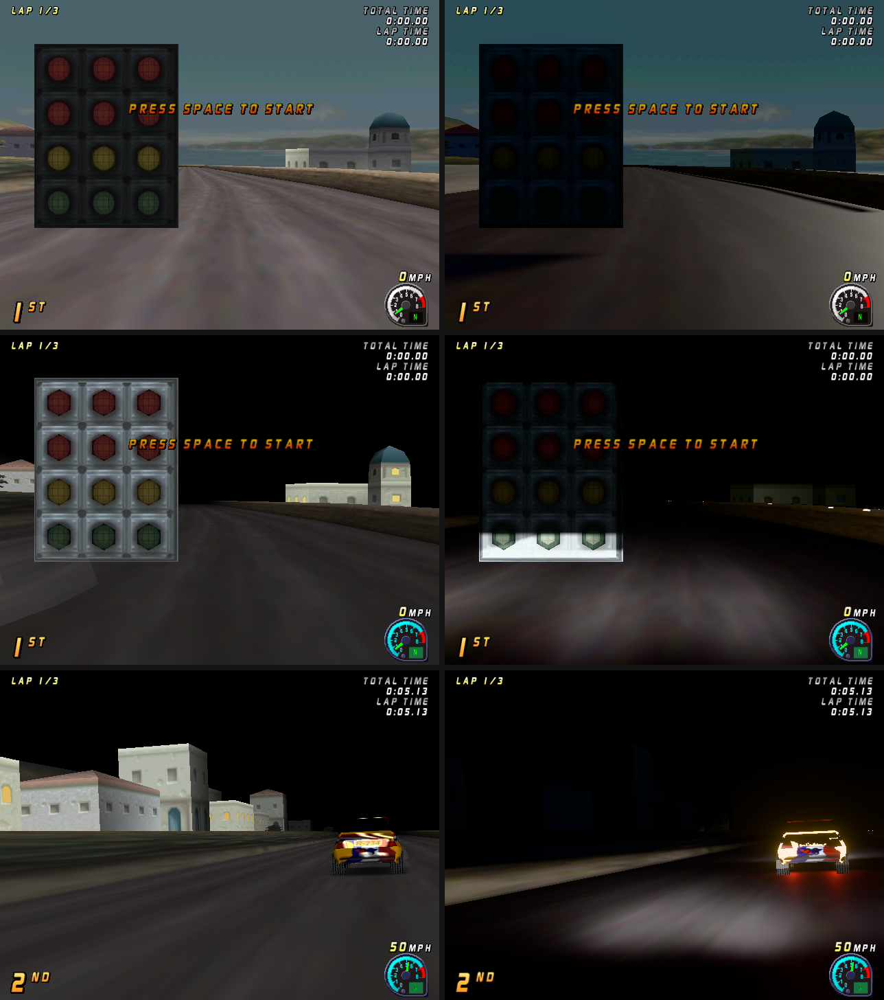
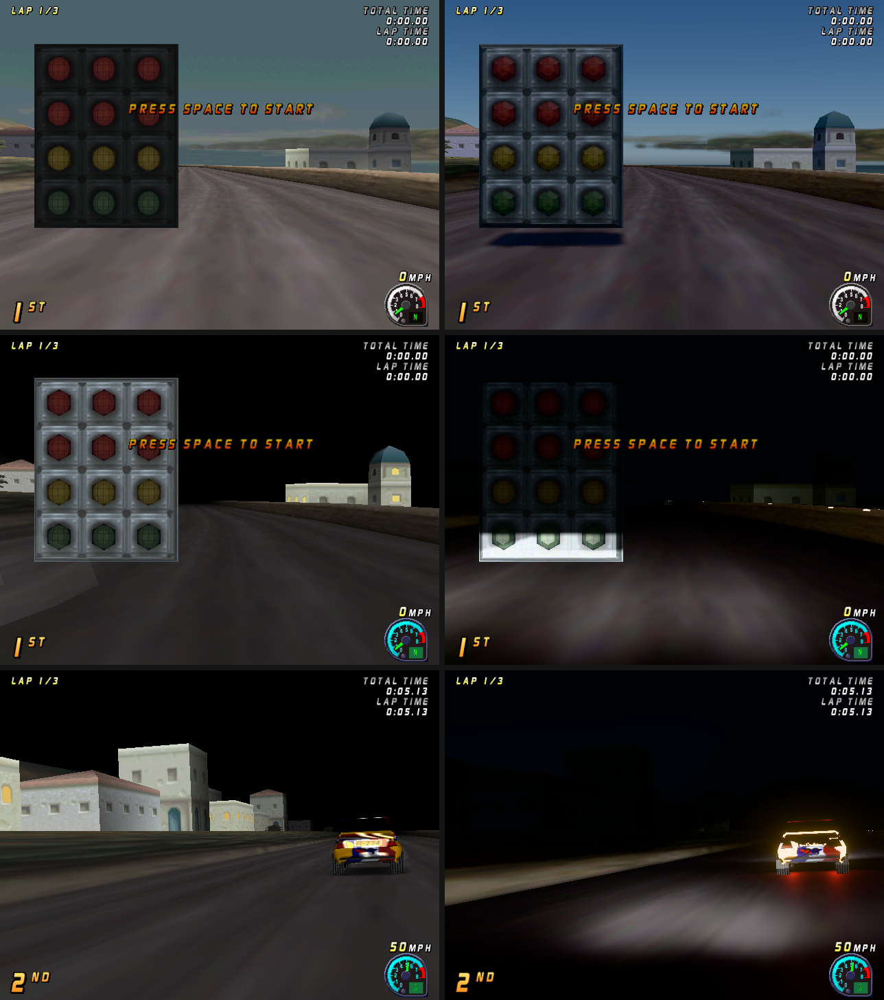
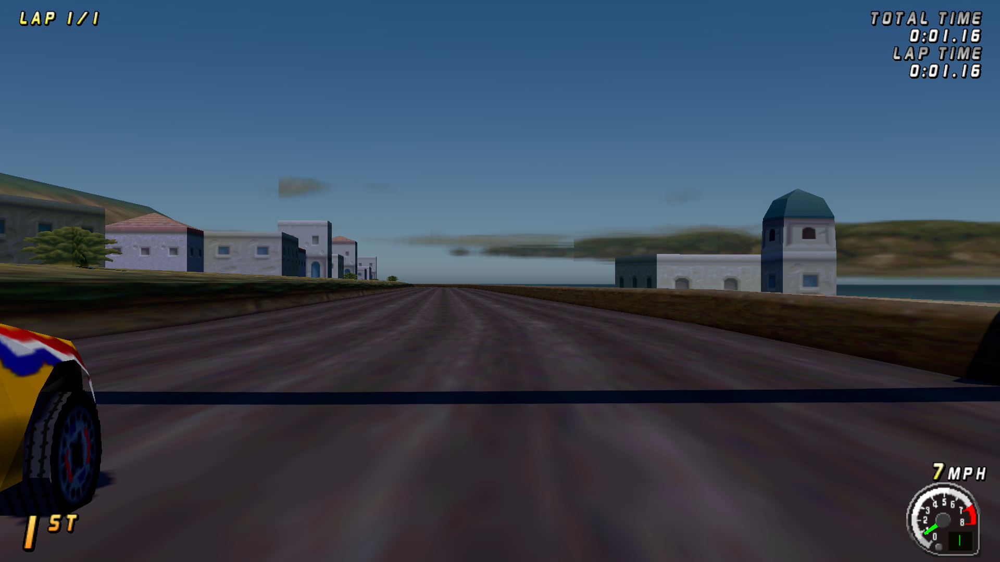

# Remastered lighting: measurements

Every number here comes from an instrument in the tree, with the command
that made it. Design: `DESIGN.md`.

## Phase 0: verification and the capture seam

### Facts settled from the code (2026-10-12)

- **Weather.** `BrRaceDifficultySet` (0x100627B0, `br_racestart.c`) sets four
  flags from the weather in the order Top Gear Rally's race set-up does
  (sunny, fog, rain, snow, night): 0 sunny, 1 fog, 2 rain (the storm), 3
  snow, 4 night. Night sets the night flag and not the rain flag: a dry
  night. The 32-bit lane's "4 = rain at night" note was wrong.
- **Reverse.** The physics has no gearbox (`br_cardrive.c`). Reverse is the
  car's control word bit 0x20000, which `br_carstep.c` turns into a negative
  drive torque (car+0xE68); a ghost or replay writes the negative torque
  itself (`br_carghostapply.c`). So: reverse lamps on while the drive torque
  is negative and the car is not moving forward; brake lamps as DESIGN.md
  2.3. The same for the player, the AI and ghosts.
- **The seam.** No handler wrappers are needed (the game itself rewrites
  table slots 4, 177 and 191 when the geometry mode changes, so wrappers
  installed once would be lost). Every display-list triangle, clipped or
  not, already tells `glide.c` its view before it is drawn (`br_dlview.h`),
  and arrives with its pixels and 1/w. The capture rebuilds the world point
  from them and the game's view x projection (`platform/light/light_capture.c`).
- **The backdrop.** The no-Z vertex routines set 1/w to 1/65535 after
  projecting (the painted sky and horizon). Those triangles have no world
  position; the capture keeps them apart as the backdrop.

### The capture, measured

`BR_VCLOCK=0.25 BR_HEADLESS=1 BR_LIGHT_CAPTURE=1 BR_LIGHT_STATS=1`, script
`20_quickrace_drive` (sunny), headless build `build/brally/light-null`:

| | |
|---|---|
| camera triangles a frame | 179 to 549 (median 520 on the opening straight, 232 later) |
| mirror triangles a frame | 0 (this camera has no mirror) |
| backdrop triangles a frame | 51 to 57 |
| largest reprojection error | 0.10 px (the rebuilt world point projected again, against where the game drew it) |
| world extent seen | x 811..1438, y 121..1175, z 0..26 (units) |

The game draws a few hundred triangles a frame: the scene is very light,
which is what DESIGN.md 8.1 counts on for the BVH.

*Frame 1,000 of `20_quickrace_drive` (`BR_LIGHT_DUMP=1000:f.obj`, a
software-renderer build, then `ports/brally/tools/lightviz.py`): the game's
frame; the 518 captured triangles drawn again through the game's camera, lit
flat by a test sun; the same triangles from behind and above the car.*

### The game never notices it

`ports/brally/tools/lightcheck.sh SCRIPT` (headless, `BR_VCLOCK=0.25`): the
script run with `BR_FLAG_LIGHTING=0` and `=1`, the game's data area dumped
every 100 frames, compared with `dumpdiff.py --state`.

| script | result |
|---|---|
| 20_quickrace_drive (sunny) | identical, 16 dumps |
| 27_quickrace_snow | identical, 17 dumps |
| 28_weather_rain | identical, 26 dumps |
| 29_weather_storm | identical, 26 dumps |
| 33_weather_fog | identical, 26 dumps |
| 38_views_keys | identical, 34 dumps |
| 21_quickrace_finish | identical except `g_aBrSfxChan` / `g_aBrSfxChanApplied` from frame 6600 |

The sound channels' records differ between two runs with the lighting OFF
in exactly the same place (frame 6600, the same two globals), so that is
existing run-to-run variation in the sound state, not the lighting.
`lightcheck.sh` leaves those two out and says so.

## Phase 1: first light (2026-10-12)

The Metal backend relights the camera's 3D view (`brr_metal.m`): each 3D
triangle writes a G-buffer beside the game's colour (albedo with the
vertex colour's brightness, the game's baked light, taken out; world
position; face normal), the frame's 3D triangles make a 2048^2 sun shadow
map, and one lighting pass computes the sun (with 3x3 filtered shadows),
the sky and the ground's light in lux, a GGX highlight, the camera's white
balance, an exposure metered from the frame's mean log luminance (EV100,
K = 12.5) and Khronos PBR Neutral. 2D, the mirror and the backdrop keep the
game's pixels. A headless Metal build (`HOST=null RENDER=metal`) takes the
shots without a window.

*Frame 1,000 of `20_quickrace_drive`: Original (left), the new lighting
(right). The sun is the default direction, 19 degrees up, behind the gantry:
its shadow lies across the road.*

*`BR_LIGHT_VIEW` 1 albedo, 2 normals, 3 sun shadow, 4 the sun's angle on
each surface.*

| check | result |
|---|---|
| Original unchanged | frames 300, 1,000 and 3,000 byte-identical PNGs against the pre-lighting commit c8194344 (same Metal renderer, headless) |
| game state | `lightcheck.sh` with the lit Metal build: identical over `20_quickrace_drive` (16 dumps) |

Not yet: emissive lamps (the gantry's lights read as plain surfaces), the
sky (the game's painted backdrop is kept), shadows from what is off screen,
GPU timing.

## Phase 2: the cars' lamps (2026-10-12)

Every car in the race (`light_game.c` reads `g_aBrRaceDriver`: body frame,
velocity, drive and brake torque, control word, model extent) carries four
lamps (`light_scene.c`): low-beam headlights (about 20,000 cd, halogen
white, the UN ECE R112 asymmetric pattern in the shader) at night, in fog and
in rain; rear lamps (tail 5 cd red with the headlights, brake 80 cd, reverse
300 cd white) from the car's own brake and reverse state. Unshadowed for
now; the lamp positions are the faces of the model's extent (the lens faces
are the refinement).

Weather 4 is night: `28_weather_rain` runs it (`BR_LIGHT_STATS` prints
weather 4) and its frames are night (black sky, lit windows); the script's
"rain" comment is wrong.

Exposure: the lighting pass bins every 16th pixel's luminance into a
64-bin histogram; the mean log luminance between its 80th and 98.3rd
percentiles (Unreal Engine's auto-exposure defaults) sets EV100 (K = 12.5).
A plain mean failed at night: the moonlit dark pulled it to EV 1.4 and the
headlit road burned out; the histogram band meters EV 2.7 there. Night's
range is EV100 -2.5 to 7.5 (moonlight to a floodlit road).

## The lit frame as passes (2026-10-12)

Relighting the game's finished frame dropped or pasted back what the game
draws blended (the lit windows are alpha-blended decals over the walls: the
colour under each window is the wall's grey). A lit frame is now the game's
draws recorded and replayed (`brr_metal.m`, `brr_metal_lit.h`): G-buffer of
the opaque 3D; the sun's shadow map; HDR lighting with the game's
background (what it drew before its 3D) and painted backdrop behind; the
blended 3D forward-lit by the same lights in the game's order (additive
draws as emitted light); bloom (13-tap down, tent up, Jimenez 2014); post
(histogram exposure over lit surfaces only, Khronos PBR Neutral); then the
game's 2D, mirror and LFB writes over it as drawn. Glow is a texture
property decided when the texture is made (lamplight texels), about
100 cd/m2 at night. Each recorded draw keeps the texture object it was drawn
with (the game replaces its font pages within a frame).

Bugs the frames showed, each fixed at its cause: glyphs all the last font
page (texture identity, above); a black night (a sliver's zero normal made
NaN, which bloom spread over the frame: guarded normals, finite bloom
input); a dark exposure (the meter read the backdrop, whose level follows
the exposure: it reads lit surfaces only); the night's black background
fill drawn over the scene (draws before the first 3D are background now).

| check | result |
|---|---|
| Original unchanged | sunny and night frames 1,000 and 3,000 byte-identical to c8194344 |
| game state | `lightcheck.sh` with the lit Metal build, `28_weather_rain` (night): identical, 26 dumps |

## Sky, sun and atmosphere (2026-10-12)

The project lead chose the sun for Coastline (high, behind the start: option
B of `sun-options.png`) and a physical sky. `brr_metal_sky.h`: Hillaire 2020
(transmittance 256 x 64, multiple scattering 32 x 32, sky view 192 x 108,
Earth's Rayleigh, Mie and ozone constants), the sun's disc at 0.2675 degrees,
the sunlight reaching the ground and the sky's light on an up-facing
surface both read from the same atmosphere (a 3 x 1 reduction, read three
frames later), and the fog's colour the air's light at the horizon. The
weather sets the haze (Mie x1 sunny, x30 fog, x12 rain, x8 snow) and how much
sun the clouds let through. The game's painted backdrop stays in front: its
hills, coast and sea; its painted sky (blue or neutral in a texel's
neighbourhood, above the horizon) gives way. Daylight white balance is to
the sun's own light, so the sky stays blue.

Found on the way: the sky's rays came out upside down (the top of the screen
looked 24 degrees down): the game sets Glide's origin to the lower left, so
its viewport's rows run up; the capture uses the game's own coordinates
(right), the sky's rays now turn the target's rows back the same way.

| check | result |
|---|---|
| Original unchanged | sunny and night frames 1,000 and 3,000 byte-identical to c8194344 |
| game state | `lightcheck.sh`, `20_quickrace_drive`: identical |

## GPU time per pass (2026-10-12)

`BR_LIGHT_GPU=1` puts Metal timestamp counters on each lit pass's first
encoder (start of vertex work, end of fragment work) and prints the
milliseconds a frame each second. The GPU starts a pass while the one
before it is still shading, so a pass is timed from the later of its start
and the previous pass's end (the frame's first pass from the last frame's
end); the passes then add up to the frame's span. `BR_SIZE=WxH` sets a
headless run's target size.

Apple M4 Pro, headless, `BR_VCLOCK=0.25`, steady state, ms a frame:

| pass | sunny 1080p | night 1080p | sunny 4K | night 4K |
|---|---|---|---|---|
| sky tables | 0.07 | 0.07 | 0.07 | 0.07 |
| G-buffer | 0.31 | 0.36 | 0.98 | 1.14 |
| sun shadow | 0.02 | 0.02 | 0.02 | 0.02 |
| lighting | 0.62 | 0.46 | 2.40 | 1.74 |
| transparent | 0.02 | 0.04 | 0.03 | 0.07 |
| bloom down | 0.06 | 0.06 | 0.24 | 0.24 |
| bloom up | 0.06 | 0.06 | 0.12 | 0.12 |
| post | 0.13 | 0.14 | 0.48 | 0.48 |
| 2D | 0.04 | 0.03 | 0.07 | 0.07 |
| **total** | **1.34** | **1.25** | **4.42** | **3.96** |

At 640 x 480: 0.67 sunny, 0.66 night. The lighting pass is the largest and
grows with the pixels; the scene's few hundred triangles make the shadow
map almost free. The iPhone and tier budgets are measured on the devices
(each phone run needs the project lead's go-ahead).

| check | result |
|---|---|
| Original unchanged | sunny frames 1,000 and 1,600, night 1,000 and 3,000: byte-identical to c8194344 |

One of eight baseline runs started together drew night frame 3,000
differently; run again, the baseline and this build agree byte for byte.
That is run-to-run variation in the baseline under load, which the
Original check has to allow for by repeating a mismatch before reporting it.

## The whole track and the sun's cascades (2026-10-12)

**The track at load** (`light_game_track`, `light_game.c`): the track's
instance table (`g_brTrkHdr.aInstances`, 0x54-byte records, the table the
scene draw walks) gives each object's model matrix (an unrotated object,
flag 0x20 at +0x4D: its scale and position) and its display list at +0x44,
walked read-only (G_VTX, G_TRI1/2, G_DL, G_ENDDL) into world triangles in
the capture's space. Coastline: 673 objects (661 unrotated), 643 lists,
11,364 triangles, x -61..2039, y -10..2116, z -3..49.

Checked against what the camera draws (`BR_LIGHT_TRACKCHECK=1`: each captured
camera vertex tested for lying within 0.05 on a track triangle): 53% of the
camera's vertices lie on the track. The rest, at frame 1,000 of
`20_quickrace_drive` grouped into connected pieces (`BR_LIGHT_TRACKOBJ`,
`BR_LIGHT_DUMP`), are what the race draws itself: the twelve start-light
bulbs (3 x 4 hexagons of 18 faces, 1.5..3.6 up), the tyre trail and the cars.
Those stay this frame's captured casters.

**Cascaded sun shadows**: four 2048^2 cascades over the view to 300 m,
split at the practical-scheme distances (lambda 0.7), each fitted by its
slice's bounding sphere and moved in whole texels; reaching back toward the
sun to the track's extent, so what is behind or above the view casts (the
start gantry's beam across the road, frame 20,000 below). Bias slope-scaled:
one texel in the cascade's depth x (1 + tan theta), the receiver pushed one
to three texels along its normal; the first fit (a flat texel) showed acne
rings in `BR_LIGHT_VIEW=3`, this one none on the road and banks.

| check | result |
|---|---|
| Original unchanged | sunny 1,000 and 1,600, night 1,000 and 3,000: byte-identical to c8194344 |
| game state | `lightcheck.sh`, `20_quickrace_drive`: identical, 16 dumps |

Headless runs draw about 17 frames a race step, so a race frame is a high
renderer frame number: the green light is past frame 10,000, and frame
20,000 is 1.16 s into the race.

## The track for rays: BVH and acceleration structure (2026-10-12)

DESIGN.md 8.1's world representation, built and verified without running
the game. `platform/light/light_bvh.c` builds a bounding volume hierarchy
over `light_game_track()`'s triangles: binned SAH (16 bins a axis,
traversal and triangle cost 1, leaves of at most 4), 32-byte nodes stored
depth first (an interior node's first child follows it, so the traversal
stacks only the far child), the triangles copied in leaf order with their
track numbers beside them, and a 16-byte surface record a triangle (object;
material, albedo and emission left zero for the materials work).
`render/metal/brr_metal_rt.m` uploads it as four buffers and, where the
device has `supportsRaytracing`, builds a primitive acceleration structure
over the same triangles in track order (compacted after the build), so both
paths name a triangle by the same number. `brr_metal_rt.h` holds the Metal
traversal (`rt_closest`, `rt_any`) and the intersector's
(`rt_hw_closest`, `rt_hw_any`), and `brr_rt_library` compiles them without
fast math (the slabs need IEEE infinities). The renderer exposes the world
as `brr_metal_rt_world()`, built the first time a pass asks for it on a
track; nothing traces rays yet.

The triangle test is Woop, Benthin and Wald's watertight test with one
change, found by the brute-force comparison: in plain float a small, thin
triangle far from the ray can lose two of its edge functions to
cancellation, and a ray 100 m away "hit" a millimetre sliver (the soup
scene, 2 rays in 20,000). The paper falls back to double precision for an
exact zero; the GPU has none. The edge functions are instead computed as a
difference of products with Kahan's algorithm (one fma each side), whose
relative error is at most two units in the last place (Jeannerod, Louvet
and Muller 2013): the sign is the exact sign and zero only when the exact
value is, which is also what makes the test watertight. Every multiply-add
in the traversal is an explicit fma on the CPU and the GPU, and the C is
built with `-ffp-contract=off`, so the two agree bit for bit.

Instruments (`ports/brally/tools/lighttest/run.sh`, which builds and runs
all three): `bvh_test` (the BVH against brute force on the CPU),
`rt_gpu` (the GPU against the CPU, through the renderer's own
`brr_rt_update`), `rt_compile` (the shader source at each language
version). Scenes: Coastline's whole track (`BR_LIGHT_TRACKOBJ`, 11,364
triangles, kept under `build/` as game data), and three synthetic ones:
soup (20,000 triangles of every size and orientation, overlapping, 1 km from
the origin), terrain (a 100 x 100 heightfield at 2 km sharing every edge,
with a flat terrace and a wall) and rooms (700 stacked 4 m boxes with shared
faces, every other box's triangles duplicated, 500 needles, 500 points and
500 slivers 40 m long and a millimetre wide). A million rays a set: random
(origins in the scene's box, directions uniform) and surface (a point on a
triangle by area, cosine-weighted about its normal on a random side, tmin a
millimetre: how GI's rays leave a hit). Any-hit gets a segment of half to
one and a half times the closest hit's distance.

Counting ties: the brute force tests every triangle in order and keeps the
first at the smallest distance; the BVH finds them in another order. A
difference counts as a tie only when both triangles are hit by the same
test at the distances reported and the two hit points are the same point to
the precision of the coordinates (one unit in the last place of the point's
largest coordinate). Every other difference fails the test.

### CPU against brute force, 1,000,000 rays a set

| scene | build | nodes | depth | SAH | closest: identical / ties / mismatches | any-hit | nodes, triangles a ray | one thread |
|---|---|---|---|---|---|---|---|---|
| Coastline, random | 11.3 ms | 11,487 | 17 | 8.36 | 999,998 / 2 / 0 | 100% | 5.1, 0.53 | 9.9 Mrays/s |
| Coastline, surface | | | | | 999,989 / 11 / 0 | 100% | 14.4, 2.71 | 3.7 Mrays/s |
| soup, random | 26.2 ms | 39,127 | 18 | 73.5 | 1,000,000 / 0 / 0 | 100% | 38.5, 1.72 | 1.3 Mrays/s |
| soup, surface | | | | | 1,000,000 / 0 / 0 | 100% | 51.1, 3.33 | 1.0 Mrays/s |
| terrain, random | 17.5 ms | 20,099 | 14 | 19.5 | 1,000,000 / 0 / 0 | 100% | 10.3, 1.23 | 5.2 Mrays/s |
| terrain, surface | | | | | 1,000,000 / 0 / 0 | 100% | 15.2, 2.27 | 3.4 Mrays/s |
| rooms, random | 8.1 ms | 9,049 | 18 | 321.5 | 730,107 / 269,893 / 0 | 100% | 128.7, 46.1 | 0.38 Mrays/s |
| rooms, surface | | | | | 496,499 / 503,501 / 0 | 100% | 170.0, 62.0 | 0.30 Mrays/s |

Coastline's ties are all at the identical distance (shared edges). Rooms'
are its duplicates and shared faces: 267,740 and 501,504 at the identical
distance, 2,153 and 1,997 a fraction of a micrometre apart (9.5e-7 m at
most, coplanar triangles whose computed distances differ in the last
places). The tree's invariants (every triangle in exactly one leaf, inside
its box, every child inside its parent) hold in every scene. Coastline's
tree is 980 KB with its surface records. As a second check of the triangle
test itself, the brute force's distances agree with Moller-Trumbore in
double precision within 1e-4 on every ray except 8 of rooms' random set
(origins that land exactly on a face with tmin 0, where any answer near
zero is right).

### GPU against CPU, M4 Pro, 1,000,000 rays a set

The compute traversal: every closest hit identical to the CPU's in
distance, both weights and triangle, and every any-hit identical, on all
eight sets (8,000,000 rays, zero differences). GPU time from the command
buffer's start and end, best of 5, one thread a ray, 64 a threadgroup;
repeated runs vary by about 15%.

| scene, rays | compute closest | compute any | hardware closest | hardware any |
|---|---|---|---|---|
| Coastline, random | 670 to 770 Mrays/s | 880 to 1,080 | 2,550 to 3,160 | 4,870 to 5,100 |
| Coastline, surface | 350 to 540 | 560 | 2,610 to 2,700 | 3,890 to 3,920 |
| soup, random | 170 to 200 | 210 | 1,570 | 2,000 |
| soup, surface | 180 | 190 | 1,190 to 1,210 | 1,480 to 1,500 |
| terrain, random | 380 to 440 | 460 to 510 | 2,150 to 3,120 | 4,160 to 4,320 |
| terrain, surface | 360 to 680 | 760 | 2,550 | 3,240 to 3,330 |
| rooms, random | 42 | 60 | 1,260 | 2,610 |
| rooms, surface | 38 | 60 | 840 | 1,590 |

The hardware structure for Coastline: built in 10 ms (the first build in a
process 21 ms), 585 KB compacted. The intersector does its own arithmetic,
so it is compared, not required to be bit-identical. On Coastline it finds
the same triangle as the CPU for 999,995 and 999,978 rays and ties for the
rest; its distances on the same triangle are within 16 units of the hit's
coordinates (about 2 mm at 2 km). Every remaining difference, on all
scenes, is one `rt_gpu` explains from the exact answer (long double) for
the triangles involved, and the run fails on any it cannot: 2 segments
ending exactly at the hit (the intersector includes the end, the CPU
excludes it), 9 rays starting on a face with tmin 0 (rooms), 3 rays passing
within 1e-7 (barycentric) of an edge no other triangle shares (soup, where
the exact answer is a miss by 8e-8 and either side may round it), and 5
hardware hits on rooms' 40,000:1 slivers 1 to 2 mm from a ray's origin,
where the exact hit is behind the origin and the CPU correctly misses. None
on Coastline's surface rays or the terrain.

The shader source compiles, run through this Mac's Metal compiler at
language versions 2.4, 3.0, 3.1 and 3.2, without fast math, with and
without the intersector, with no warnings (`rt_compile`). The offline
compiler (`xcrun metal`) is not installed on this Mac (Xcode reports the
Metal Toolchain component uninstalled), so the `-sdk macosx` and `-sdk
iphoneos` offline compiles are still to do once it is. `brr_metal_rt.m` and
`light_bvh.c` compile for iOS 16 (arm64) and macOS 12 (x86_64), and the
game links (`HOST=null RENDER=metal ports/brally/link64.sh`, no warnings).

Against DESIGN.md 12's acceleration structure budget (15 MB T0, 40 MB T1
and T2): Coastline's world is 1.6 MB with both representations. At the
measured rates a T1 frame's GI probe update (32x32x8 probes x 3 cascades,
a quarter a frame, 64 rays each: about 400,000 rays) costs about 0.15 ms of
hardware tracing or 0.7 ms in the compute BVH on this GPU, before shading.

## Soft sun shadows (2026-10-12)

Three changes to the sun's shadows (`brr_metal_lit.h`, `brr_metal.m`, the
arithmetic in `brr_shadow.h`), verified by arithmetic alone: the game was not
run for any of this. `ports/brally/tools/lighttest/run.sh` builds and runs
every check below (CPU programs, and the shader's own functions on this
Mac's GPU in compute kernels over synthetic maps, with Metal's validation
layer on); it needs no game data.

**Soft shadows from the sun's disc.** The sun is 0.535 degrees across, so a
blocker D metres above a surface casts a penumbra 2 D tan(0.2675 degrees)
wide, 9.3 mm per metre of D. Each cascade evaluation (PCSS, Fernando 2005,
for a directional light) searches for blockers over a disc as wide as the
penumbra of the farthest possible caster (the window reaches back toward
the sun to it, so the receiver's depth gives that distance; 16 gathers, 64
texels), takes the blockers' mean depth, and filters 24 hardware comparisons
over a disc of radius D tan(0.2675 degrees). For a straight edge that is the
share of the sun's disc in view: the physical profile, not only its width.
Both discs are Vogel (golden angle) discs turned per pixel by interleaved
gradient noise; widths are capped at 16 texels (about 35 cm in the nearest
cascade, a blocker 75 m up). The cascade blend is kept. The cascades'
constants carry metres per unit of depth (`LU.cdepth`) and the sun's angular
radius (`LU.csoft`).

**Contact shadows.** From each lit pixel, a march toward the sun over 0.5 m
in the G-buffer's world positions, one step per pixel the march crosses on
screen (at most 16, none when it stays inside its own pixel), jittered per
pixel. A step is shadowed when the surface seen at its pixel is nearer the
camera than the step by less than a thickness (two steps, plus about four
pixels of depth at 1080p) and stands off the receiver's own plane by 2 cm
(so a flat receiver never shadows itself). Hits fade out over the march's
last quarter, where the cascades take over; the sun's visibility is the
lesser of the two. The world to pixel map (`LU.scr`) is the inverse of the
sky's camera ray, checked against it below. `BR_LIGHT_VIEW=6` shows the
contact shadow alone, `BR_LIGHT_NOCONTACT=1` turns it off.

**The static cache.** Each cascade's window is an eighth wider than its
slice's bounding sphere and moves in steps of an eighth of its width (256
texels): anywhere within a step the sphere stays inside, so the matrix
holds still to the bit until the slice crosses a step. Its reach toward the
sun moves in 16 m steps. The track is drawn into a cache array only when a
cascade's matrix or the track changes. The moving casters are the frame's
opaque 3D less what lies on a track triangle (each corner within 0.05 of the
same one, `light_capture_ontrack`; the track's own shadow already holds
those): the cars, the start lights, what the race draws itself. Per frame
and cascade, the live map is restored from the cache where last frame's
movers were (a region blit; the whole slice after a redraw), the movers are
composited over the cache's depth in a scratch tile their size (the
cascade's matrix cropped to the tile: the same texel grid), and the tile is
blitted in. A cascade with no movers now or last frame costs nothing. The
blits for all the cascades share two encoders.

### The checks

`ports/brally/tools/lighttest/run.sh`, Apple M4 Pro.

The penumbra, on the CPU twin of the shader (`shadowcpu.h`, step for step,
the hardware's gather and filtered comparison written out): the sun
overhead, 2 cm texels, a flat blocker D above a flat receiver over half the
map; 2,401 receivers 0.5 mm apart across the edge, each at 64 turns of the
discs. "Width" is the span where the mean over the turns is strictly between
0 and 1, less the one texel the hardware's bilinear comparison adds; "rms"
and "max" compare the mean with the physical profile (the share of the
sun's disc in view) seen through that one-texel comparison; "noise" is the
largest standard deviation over the turns at one receiver (what one pixel
can show before any temporal filter); "drops" counts places where one
turn's result gets darker moving away from the blocker.

| D | 2 D tan, mm | width, mm | off by, texels | rms | max | noise | drops |
|---|---|---|---|---|---|---|---|
| 0.05 m (contact) | 0.47 | 0.5 | 0.00 | 0.0000 | 0.0010 | 0.000 | 0 |
| 2 m | 18.68 | 18.5 | -0.01 | 0.0001 | 0.0010 | 0.007 | 0 |
| 5 m | 46.69 | 46.5 | -0.01 | 0.0001 | 0.0010 | 0.011 | 0 |
| 10 m | 93.38 | 92.5 | -0.04 | 0.0001 | 0.0006 | 0.013 | 0 |
| 20 m | 186.75 | 184.5 | -0.11 | 0.0001 | 0.0007 | 0.018 | 0 |
| 40 m | 373.50 | 369.5 | -0.20 | 0.0003 | 0.0020 | 0.026 | 0 |
| 60 m | 560.25 | 554.5 | -0.29 | 0.0004 | 0.0023 | 0.028 | 0 |

Every width is within a third of a texel of 2 D tan(0.2675 degrees) (the
outermost of 24 Vogel points sits at 0.99 of the radius, hence the slight
shortfall growing with D); the contact case is a hard edge, its whole
transition one texel (20.5 mm); receivers well inside the shadow are
exactly 0 and well outside exactly 1, at every turn.

The same functions on the GPU against the CPU twin, all 153,664 receivers
per D: the largest difference 7.1e-4 (the hardware's 1/256 texel sample
positions); no darkening away from the blocker on the GPU either; the GPU's
own penumbra widths the same within 1 mm. At 60 m, 2 receivers of
153,664 differ by one sample of 24: at the penumbra's outermost tip (shadow
under 4%) the GPU's blocker search missed the blocker's last texel column
that the CPU's caught, and took PCSS's "no blocker, fully lit" exit. That
exit is PCSS's own discontinuity, bounded by the shadow the search's gaps
can hide at the rim.

The cache, a simulated drive (`shadowtest.c`): 3,920 static triangles
(ground and 60 posts over 400 m), three cars as moving casters, four
cascades of 256^2 through `brr_cascade_fit`, `brr_shc_plan`, `brr_shc_rect`,
`brr_shc_tile`, every live map compared bit for bit with the scene drawn
from scratch with the same matrix, every frame:

| phase | static redraws, cascades 0..3 |
|---|---|
| camera still 20 frames, cars moving | 1 1 1 1 (the first frame only) |
| driving 0.3 m a frame (18 m/s), 300 frames | 20 11 5 1 |
| the track rebuilt | 1 1 1 1 |
| turning 1 degree a frame, 60 frames | 3 4 8 7 |

Live maps differing from brute force: 0 of 1,524. Redraws without a matrix
change: 0; matrix changes without a redraw: 0. The moving casters are in
the live maps (568 texels a frame nearer than the cached track). Slice
corners outside their window: 0. The cropped tile matrix puts every point
within 7.6e-6 texels of its map texel less the tile's corner.

On the GPU: the region and whole-slice restore blits are bit-exact (0
texels differ, 0 outside the region changed). The tile path against drawing
the movers straight into the slice (a dozen triangles over random cache
depths, the game's depth bias): 0 texels changed outside the rectangle;
6,338 inside differ, by at most 8.4e-6 in depth (1% of one texel's depth,
0.4 mm at that test's scale), from the rasteriser snapping corners to 1/256
texel at positions the crop moves by 1e-5 texel. No covered texel changes.

The world to pixel map against the sky's camera ray (2,000 random cameras,
viewports, screen maps, both row orders): the ray through the computed
pixel passes the point within 1.2e-5 rad.

The contact shadow against ray-traced truth (a 30 x 30 x 12 cm block on
flat ground, the sun 33 degrees up behind it, a 320 x 240 G-buffer ray
traced through the game's camera conventions): of 214 ground pixels the
block shadows within 0.30 m along the sun, 196 (91.6%) found; the 18 missed
are rays that only graze the block's corner between steps, or stay within
the 2 cm plane margin before leaving its side. Of 74,445 ground pixels with
nothing within 0.55 m, 2 shadowed: the method's silhouette fringe (a point
just behind the block's top edge cannot be told from one inside it by a
single depth layer; a fixed 0.25 m thickness gave 8, the thickness used
gives 2 with the same 196 found). GPU and CPU agree at all 74,659 ground
pixels.

The whole shader source, extracted as `brr_open` builds it, compiles with
the system's Metal compiler with no diagnostics and holds all 18 functions
the lit frame makes pipelines of; the LU struct is 560 bytes in the shader
and in C. Not done: the offline `metal` compiles for macOS and iOS. This
Mac's Xcode 27 ships the offline compiler as a separate component (the
Metal Toolchain, `xcodebuild -downloadComponent MetalToolchain`), not
installed; installing it is the project lead's call. `run.sh` uses it when
present.

`HOST=null RENDER=metal ports/brally/link64.sh` builds and links with no
warnings.

### Cost

Per lit pixel: the sun's visibility is 16 gathers and 24 filtered
comparisons a cascade evaluation (40 texture reads, against 9), twice in the
blend bands (the last tenth of each cascade); none on a face turned from the
sun; 16 where no blocker is in reach (most lit ground). One sincos a pixel;
the disc points are constants once the loops unroll (turned by a 2 x 2
rotation, 4 FMAs a point). The contact march: up to 16 reads of the 16-byte
position texel and a 4 x 4 transform each; none where the cascades already
shadow fully or the march stays inside one pixel.

Measured in compute kernels over a 1920 x 1080 G-buffer of ground seen from
2 m (four 2048^2 cascades split at the fit's distances, half the ground
under a 10 m blocker), M4 Pro, milliseconds over the G-buffer reads alone,
the range of the medians of six runs (other work was sharing the GPU):

| | ms at 1080p |
|---|---|
| sun, the previous 3x3 filter | 0.13 to 0.23 |
| sun, PCSS | 0.35 to 0.56 |
| contact march | 0.46 to 0.66 |
| sun and contact, as the lighting pass does them | 0.52 to 0.79 |

So the soft sun and contact shadows add about 0.4 to 0.6 ms at 1080p on
the M4 Pro over the 3x3 filter. An A15-class phone GPU has roughly a
quarter of the M4 Pro's throughput: an estimated 1 ms more at T0's 1280 x
720, against DESIGN.md 12's 1.6 ms for culling and shadows together. The
knobs if a device run shows it over budget: 12 and 16 samples instead of 16
and 24, and 8 contact steps.

The shadow update (the maps themselves): a height field of 11,250
triangles (as many as Coastline's track) and 36 moving triangles in a 276 x
180 texel rectangle, M4 Pro, the minimum of 41 runs (the work itself; the
medians, 0.5 to 0.9 ms, carry the other load), two runs:

| | min, ms |
|---|---|
| before: four maps drawn afresh each frame | 0.25 to 0.28 |
| cache, movers in 2 cascades | 0.13 to 0.14 |
| cache, movers in 4 cascades | 0.17 |
| cache, no movers | 0 |
| cache, a frame that redraws one cascade | 0.18 to 0.21 |

A depth pass costs its whole 2048^2 attachment however little it draws
(measured: 0.07 to 0.09 ms a slice, about the same for a 256^2 draw as for a
full one, whatever the load action), a 256^2 region blit 0.005 ms, and an
encoder about as much as the texels a small blit moves: hence the tiles and
the shared blit encoders. The simulated drive redraws cascade 0 once in 15
frames at 18 m/s, cascade 3 once in 300.

Memory: the cache doubles the cascades, 64 MB more (two 2048^2 x 4 arrays of
32-bit depth, 128 MB), plus a tile per cascade grown to the largest it has
needed (1 MB at 512^2). The live array alone was already over DESIGN.md
12's 40 MB for T0's sun and local shadows: T0 needs 1024^2 cascades or
16-bit depth (a quarter or half of this), a tier decision for the device
runs.

The CPU's share: the on-track test is one grid lookup and a point to
triangle distance per candidate in the centroid's cell, for a few hundred
triangles a frame.

### Open

- No frame of the game has been looked at with these changes (the project
  lead's rule for this work: verification by arithmetic). The first look
  should be `BR_LIGHT_VIEW=3` (the sun's visibility) and `=6` (contact
  alone) on Coastline, sunny, with `BR_LIGHT_STATS=1` for the cache's
  redraw and composite counts on a real drive.
- The penumbra's per-pixel grain (up to 0.028 standard deviation in the
  widest penumbrae) waits for the temporal filter DESIGN.md 4 plans.
- The offline compiles for macOS and iOS, once the Metal Toolchain is
  installed.
- `BR_LIGHT_GPU` times a pass's first encoder only; the shadow update is
  several encoders and blits, so its line there undercounts it.

## Many lights: clusters and the lamps' shadow atlas (2026-10-12)

DESIGN.md 7.4's clustered culling and shadow atlas, for every lamp of the
20-car night grid. Verified without running the game: the CPU code against
brute force, the renderer's own shader code on the GPU in a standalone
harness with synthetic scenes, the whole shader source compiled, and the
game linked. `ports/brally/tools/lighttest/lights.sh` runs all of it (and
`run.sh` with the other suites).

**Clusters** (`platform/light/light_cluster.c`). The camera's view in 16 x 9
screen tiles (equal steps of its clip x/w and y/w) and 24 depth slices: the
first to 2 m, 22 exponential ones from 2 m to 600 m, the last open beyond.
The outermost tiles and the first and last slices drop their outer plane,
so any point in front of the camera has a cluster that holds it. A light's
reach is a sphere of its range (a point; the reserved rect and tube kinds,
whose range is to cover their emitter) or a sphere-capped cone of its outer
angle (every other kind), and the extent of such a body along a plane's
normal has a closed form (the cap's direction nearest the normal is at
max(psi - theta, 0) from it), so a light stays in a cluster unless it lies
wholly outside one of the cluster's six planes. Those planes separate by
axis, so each light is tested against 16 + 9 + 24 tiles' planes and the
clusters are the products (128-bit masks); a closed cluster then also drops
a cone that misses its bounding sphere (a conservative cone and sphere test).
Every test keeps a margin of 5 cm plus 1e-5 of the distances, for the
rounding between the CPU and the shader. The build runs on the CPU (0.3 to
0.45 ms for 128 lights on one M4 Pro core) and goes up with the lights and
the shadow tiles in one buffer a frame (`LightSet`, 466 KiB, three in
flight); the shader only finds a point's cluster (`lc_index`, its slice
settled against the same boundary table) and walks its list (`lamps()` in
`brr_metal_lights.h`, used by the deferred lighting and the forward pass
alike).

Light types: the low beam and the rear lamp as before, a point, and a spot
(inner and outer cone); rect and tube are reserved kinds the culling
already bounds. The low beam now has an outer cone of 70 degrees (a soft
edge from 64): past it the R112 pattern is under 1% of its peak. The rear
lamps keep their half space.

**Lamp shadows.** A 4096^2 Depth32Float atlas on the Mac (64 MiB), 2048^2
(16 MiB) on the iPhone. Each low beam or spot in view (cones up to 80
degrees: no perspective tile holds a rear lamp's half space, and points wait
for octahedral tiles) gets a square perspective tile around its cone, near
plane 0.25 m (its own lens and bumper are nearer), far plane its range.
Importance is candela x screen coverage (its tiles over all tiles) /
distance^2 from the eye, x 1.25 for a lamp that held a tile last frame; the
tile is 1024 texels for a quarter of the screen or more, then 512, 256,
128; while the tiles exceed the atlas the least important is halved, the
most important lamps keeping theirs. Tiles are aligned power-of-two blocks
of 128-texel cells, last frame's places kept where they still fit, the rest
placed largest first in Morton order (which always packs a set whose area
fits; a fragmented atlas is packed afresh). A tile is drawn again only when
its lamp, its place or the moving casters near it (this frame's captured
triangles in the lamp's reach, hashed) changed, the most important first,
within a budget of texels a frame (the whole atlas); a tile that misses the
budget keeps last frame's depth and the transform it was drawn with, and
one with no depth yet is unshadowed for the frame. Casters: the track's
triangles binned at load into 16 m cells (each cell's extent tested against
the lamp's frustum) and the frame's moving objects. Sampling: the receiver
pushed along its normal one to three texels of the tile at its depth (three
at grazing light, so the kernel's nearest row stays on the receiver's far
side), compared nearer by one texel x (1 + tan theta), 3 x 3 bilinear
comparisons kept inside the tile. A new GPU pass, "lamp shadows", follows
the sun's cascades in `BR_LIGHT_GPU`; `BR_LIGHT_VIEW=7` shows the lights a
pixel's cluster lists; `BR_LIGHT_STATS` prints the clusters and the plan.

| check | result |
|---|---|
| cluster lists, CPU (300 random cameras, up to 128 random lights of all four kinds, 5.6 M points in view and in lights' reach) | 26.3 M (point, light) pairs reaching: none missing from the point's cluster |
| false positives | 12.05 lights listed a point, 4.70 reaching it: 61% of listings do not reach the point; per cluster, 32% of listings reach none of 512 samples inside it |
| cluster lists, GPU (`lc_index`, `lamp`, `lwin` as compiled for the renderer; 100 cameras, 6.6 M points) | 32.9 M pairs reaching on the GPU: none missing from the shader's walk of the cluster list |
| GPU against CPU | cluster index equal at all but 1,269 points (a boundary, by rounding); reach equal but for 539,946 pairs where the CPU's light is under 1e-30 cd (the GPU flushes it to zero) and 965 at a range or cone edge (what the margin covers) |
| a point in a lamp's cone (312,237 points, 2,000 random lamps) | inside its atlas tile and 0 <= z/w <= 1: all |
| depth along 40,000 rays from the lamp | increases with distance at every step |
| occluder (a 2 x 2 m board 10 m in front of a spot 1 m up, the ground to 55 m) | the shader's test in C and on the GPU: 108,550 ground points, 0 wrong (behind the board under 0.05, in the open over 0.95; the 3-texel penumbra and the board's foot left out); the first bias (1.5 texels along the normal) lost 5 to 10% to grazing acne at 25 to 55 m |
| the drawn tile against a ray cast | 130,074 texels: mean relative depth error 1.6e-5, largest 4.1e-4 |
| allocator | 80 lamps in the 4096^2 atlas: all placed (14 at 1024, 3 at 512, 63 at 128), none overlapping; 80 in 2048^2: all placed; 128 lamps all wanting 1024: all placed; 500 frames of 20 to 127 lamps coming and going: all placed, none overlapping |
| cache | a still frame draws no tile; one lamp moved, one tile; a caster near one lamp, the tiles whose reach it is in; a 4 Mtexel budget: 22 tiles drawn, 58 kept |
| track casters (200 lamps, 12,000 random triangles) | every triangle in a lamp's reach drawn into its tile; 136 a lamp |
| clustered against every light, the grid at 1080p on the GPU | the same light to the bit at all 1.23 M lit pixels |
| shader source | the renderer's whole source (as `brr_open` assembles it) compiled by this Mac's Metal compiler; G-buffer, lighting, forward, sun shadow and atlas pipelines built |
| build | `HOST=null RENDER=metal ports/brally/link64.sh` links; `brr_metal.m`, `light_cluster.c`, `light_scene.c` compile for arm64 iOS |

The offline compile (`xcrun -sdk macosx|iphoneos metal -c`) needs Xcode's
Metal Toolchain component, which is not installed here; `lights.sh compile`
does it once it is.

**The 20-car night grid**, synthetic (`scene.h`): two columns, 8 m between
rows, each car's two low beams (20,000 cd, 150 m) and two tail lamps (5 cd,
25 m), a chase camera 6 m behind and 2.2 m above the last car, 1920 x 1080.

| | |
|---|---|
| cluster build, shadow plan (CPU) | 0.31 to 0.35 ms, 0.06 to 0.08 ms |
| lights listed a ground pixel | 18.3 (longest list 48) instead of 80 |
| lights reaching it | 14.5: 2.9 low beams (all shadowed), 11.5 tail lamps |
| shadow tiles | 40 (the low beams), 16.4 Mtexels |
| GPU, M4 Pro (20 cores), the lamps alone, median of 41, over five runs | clustered and shadowed 1.04 to 1.55 ms; every light, shadowed 2.20 to 3.20 ms; clustered unshadowed 0.92 to 1.57 ms; the atlas, 40 tiles of 242 casters, 0.14 to 0.43 ms |

The spread between runs is the GPU's clock; clustered is 2.0 to 2.3 times
faster than every light in each run, and the shadows cost little beside
the light itself.

Cost per pixel, counted from the shader: a listed light about 25 ALU
operations (its record, the distance, the normal test); a reaching low beam
about 165 (the pattern's two atan2 and three exp, the windows, the BRDF); a
reaching tail lamp about 85; a shadow lookup about 75 and nine bilinear
compares. The grid's mean ground pixel: 18.3 x 25 + 2.9 x 165 + 11.5 x 85
+ 2.9 x 75, about 2,140 operations and 26 compares, 2.6 G operations a
frame at 1080p. The M4 Pro's 20 cores at about 4 T simple operations a
second give 0.65 ms; the measured 1.0 to 1.5 ms is about half that rate.
Scaled by GPU throughput (estimates until measured on the devices): an
A17 Pro (6 cores, about 3.8 times less) about 4 to 6 ms at 1080p, and at
T0's 1280 x 720 about 1.8 to 2.6 ms on an A17 Pro, more on A15/A16: over
DESIGN.md 12's 1.6 ms for T0's direct light. The tail lamps are most of it
(11.5 a pixel at 85 operations): a 5 cd lamp gives 0.008 lux at its 25 m
range, against a night exposure whose mid grey is near 8 lux. A range from
each lamp's intensity and the exposure (where it falls under 1% of mid
grey: 8 m for a tail lamp, 31 m for a brake lamp) would cut that by about
ten; it changes what the lamps light, so it is the project lead's call.

Not done here (the game was not run for this work): the lit frames, the
Original check and `lightcheck.sh` with this build; with the flag off none
of this code runs (it is all inside `lit_present`).

## Verification suite (2026-10-12)

The lighting's maths checked by mathematics, without running the game:
`ports/brally/tools/lighttest/run_all.sh` builds a standalone Metal program
(`lighttest.m`) and prints PASS or FAIL with its numbers for every check
(69 now, about 12 s on the M4 Pro). The program includes the renderer
itself (`brr_metal.m`), so the shader source it compiles is the renderer's
own string expression (`k_src` with `BRR_LIT_SRC` and `BRR_SKY_SRC`, as
`brr_open` compiles it), the pipelines are the renderer's (`lit_init`), and
the C it calls (`lit_exposure`, the weather and sky tables) is the
renderer's. Its test kernels (`kernels.metal`) are appended to that source
and call the shader functions as they are; full-screen passes (the sky
tables, bloom, post) run through the renderer's own pipelines. Every result
is checked against a closed form or a CPU double-precision reference
(`ref.h`: the Khronos PBR Neutral reference ported to C, Earth's atmosphere
with Hillaire 2020's published constants, IEC 61966-2-1 sRGB, UN ECE R112's
photometric table). Every value read back from the GPU (9.15 million) is
also scanned for NaN and infinity.

### Results

Before: the shaders at efc443b0. After: this commit. Thresholds are set by
the precision of what is measured (Monte Carlo noise, half float storage).

| check | before | after | threshold |
|---|---|---|---|
| white furnace, GGX + diffuse, 12 roughnesses x 6 view angles, 1M samples a cell | max 1.794 (roughness 0.045, mu 0.03); 1.352 at roughness 0.25, mu 0.1 | max 1.0007; every cell 0.9990 to 1.0007 | <= 1.001 |
| GGX lobe energy vs double reference | 4.2e-3 (1.0042 at roughness 0.045) | 9.0e-6 | 2e-3 |
| diffuse albedo = 1 - E_spec(v) | not so coupled | 1.0e-3 | 2e-3 |
| reciprocity f(v,l) = f(l,v), 65,536 triples | 5.0e-6 | 6.7e-5 | 1e-4 |
| Fresnel at normal incidence | 0.039999 | 0.040000 | 0.04 +- 1e-4 |
| Fresnel vs Schlick, 0 to 89 degrees | 4.4e-5 | 6.4e-7 | 1e-3 |
| zenith transmittance vs closed form (tau 0.06624, 0.14675, 0.27615) | 0.9360 0.8628 0.7563, 3.1e-3 off | 0.9360 0.8638 0.7588, 3.1e-4 off | 2e-3 |
| transmittance table vs exact optical depth, 400 rays above the horizon | max dT 0.0051 | 0.0010 | 0.01 |
| sun at the ground vs 128,000 lux x exact T, 5 elevations | 5.2e-3 | 2.1e-3 | 1e-2 |
| zenith sky, sun overhead | 3,651 cd/m2 | 4,191 cd/m2 | 2,000 to 10,000 |
| zenith sky vs CPU reference, sun 90 / 54 / 30 / 10 / 5 degrees | -14.8 / -3.9 / -3.5 / -2.7 / -2.2% | -2.2 / -1.9 / -1.7 / -0.9 / -0.4% | 5% |
| sky light on the ground vs CPU reference | -2.8% at worst | -0.4% at worst | 5% |
| multiple scattering table vs CPU reference (Hillaire 5.5, converged) | 6.2% of the table's peak; 12% of a value | 0.38% of the peak; 1.3% of a value | 5% of the peak |
| f_ms (the series' ratio) | 0.332 max | 0.332 max | < 1 |
| (sky + sun at the ground) / (top x mu_s) | 0.51 to 0.97 | 0.51 to 0.97 | <= 1 / (1 - 0.3) |
| Rayleigh and Cornette-Shanks phases over the sphere | 1.000001, 0.999999 | same | 1e-3 |
| sky view mapping round trip | 0.040 degrees | same | 0.05 |
| sun disc integrated vs the sun's illuminance | 0.954 | 1.004 | 1% |
| PBR Neutral vs the Khronos reference, 200,000 colours | 1.6e-7 | same | 1e-5 |
| PBR Neutral: 0 to 0; monotonic (grey ramp; luminance of 64 hues x 2,000 scales) | yes | yes | |
| post: an HDR texel past half float (the sun's disc: 1.66e9 cd/m2) | black (inf, then NaN in the tonemap) | 249 249 249 (60,000 shows 248) | not black |
| exposure, 6 synthetic scenes (log-uniform, log-normal, sky and road, night, fog) | -0.002 to -0.014 EV | -0.001 to +0.001 EV | 0.05 EV |
| exposure, a uniform scene, 41 luminances over a stop | 0.250 EV | 0.031 EV | 0.05 EV |
| exposure clamps to the weather's range; an all-inf scene metered | not metered | 16.000; 16.000 | |
| R112 B50L 0.57U 3.43L (max 350 cd) | 200 | 127 | |
| R112 BR 1.0U 2.5R (max 1,750) | 285 | 238 | |
| R112 75R 0.57D 1.15R (min 10,100) | 19,975 | 19,036 | |
| R112 75L 0.57D 3.43L (max 10,600) | 16,706 | 1,163 | |
| R112 50L 0.86D 3.43L (max 13,200) | 16,706 | 9,684 | |
| R112 50R 0.86D 1.72R (min 10,100) | 19,978 | 19,978 | |
| R112 50V 0.86D 0 (min 5,100) | 19,666 | 17,066 | |
| R112 25L / 25R 1.72D 9L / 9R (min 1,700) | 9,577 / 13,135 | 4,802 / 13,166 | |
| R112 zone III, above the cut-off (max 625) | 12,019 at 5.95R 1.5U | 240 | |
| R112 zone IV (min 2,500) / zone I (max 2 x I(50R)) | 14,476 / 19,942 | 6,778 / 19,989 | |
| cut-off line (R112's steepest log gradient), left of V-V | 0.305U | 0.565D | 0.57D +- 0.1 |
| rear lamp: cd cos^1.5 | exact | exact | |
| bloom: constant image out = in | exact | exact | 2e-3 |
| bloom: delta impulse energy, float targets, away from the edges | 1.000000 | 1.000000 | 1e-4 |
| bloom: delta impulse energy, the renderer's half float targets, 512 x 256 | 0.9944 | 0.9944 | 1% |
| bloom down pass: NaN and inf input | finite | finite | |
| delit: albedo independent of the baked light (x1 to x0.12) | 1.0e-6 | 1.1e-6 | 1e-5 |
| delit: grey vertex colour gives 0.85 x lin(texture) | 0.7277 x (14.4% off) | 0.8500 x | 1e-3 |
| delit within 0 to 0.9 | yes | yes | |
| lin and srgb1 vs IEC 61966-2-1; round trip | 2.2e-7; 2.6e-7 | same | 1e-5; 1e-4 |
| facen: no face gives straight up; planes give their normals | yes | yes | |
| brdf, radiance and fog finite over 300,000 random and degenerate inputs | yes | yes | |

The run also prints the white albedo by roughness and view cosine and the
GGX lobe's own energy. Its loss, the multiple scattering a single-scattering
lobe drops, is 0.4% at roughness 0.25, 30% at 0.7 and 69% at 1.0, at normal
view.

The sunny sky's physical numbers: the sun at the ground 111,563 lux overhead
and 108,103 lux at Coastline's 54 degrees (128,000 lux at the top of the
atmosphere times its transmittance); the sky's light on an up-facing
surface 9,280 and 8,562 lux; the zenith sky 4,191 and 1,790 cd/m2. The
1,790 cd/m2 at 54 degrees is what Earth's constants give (the CPU reference
integrating them gets 1,824). One headlamp's pattern carries 946 lm.

The bloom chain conserves energy exactly in float targets away from the
frame's edges (1.000000 at 2048 x 1024). On a 512 x 256 frame its 8 x 4 level
reaches the edges and clamping loses 0.39%; the renderer's half float
targets lose another 0.17%. Neither is a defect.

### Defects found and fixed

Each was found by a failing check, its cause identified with a further
measurement, and fixed once. Original rendering is untouched: `k_src` (the
Original shaders) and every path outside the lit frame are unchanged. The
new BRDF table is drawn once at start-up into its own texture; with the lit
pipelines, all of `lit_init` takes about 21 ms on the M4 Pro.

1. **The BRDF reflected more than arrives** (`brdf`). The diffuse was
   weighted by 1 - F(h.v), which ignores what the specular lobe takes at
   grazing views: white reflected 1.794 at roughness 0.045 and view cosine
   0.03, and 1.352 at roughness 0.25 (the rain's wet road) and 0.1. The
   diffuse is now coupled to the lobe through its directional albedo E, as
   Kelemen and Szirmay-Kalos 2001 and Kulla and Conty 2017 couple them:
   (1 - E(n.l))(1 - E(n.v)) / (pi (1 - E_avg)). White then reflects what
   arrives, to the table's precision: every cell 0.9990 to 1.0007. E is a
   64 x 64 table made at start-up from the shader's own specular function
   (`brdf_lut`, sampling the visible normals, Heitz 2018), over the square
   root of the cosine and from the roughness floor up; E_avg is integrated
   from the table itself through the lookup `brdf` makes (`brdf_avg`). A
   closed-form coupling (Shirley et al. 1997, 1 - F(n.v)) was tried first
   and rejected on its own numbers: it lost half the light of rough surfaces
   at grazing views (white 0.49 at roughness 0.7, cosine 0.1: the road 20 m
   ahead).
2. **The GGX denominator lost precision on smooth lobes** (`brdf`):
   (n.h)^2 (a^2 - 1) + 1 cancels in float, and the lobe held 1.0042 of the
   light at roughness 0.045. Now 1 - (n.h)^2 is computed as |n x h|^2:
   1.0000, 9e-6 off the double reference everywhere.
3. **The transmittance table's edges** (`trans`, `atm_t`): its texel centres
   did not reach the unit range's ends, so the zenith seen from the ground
   read as 11.5 degrees off it, and even steps of 2.5 km missed 16% of the
   haze's 1.2 km layer: 3.1e-3 off the closed form. Now Bruneton's
   unit-range mapping, with steps growing with the square of the distance:
   3.1e-4, and the table within 0.0010 of exact everywhere above the
   horizon.
4. **The sky view undercounted the haze** (`atm_sv`): even 3.3 km steps
   straight up made the zenith under a high sun 14.8% dark. Steps now grow
   with the square of the distance, as Hillaire's implementation spaces
   them: 2.2%.
5. **The multiple-scattering table's directions** (`atm_ms`): 64 even
   directions straddled the horizon's cosine, where the light jumps (the
   sunlit ground below, the sky above), and missed the long paths just above
   it: 6.2% of the table's peak off a converged reference at 30 km. A CPU
   run of the shader's own sampling matched the GPU to four digits, so the
   integration was right and the directions were the error. Now 256
   directions split at the horizon, 32 cosines a side: 0.38%. The table is
   made only when the weather's haze changes.
6. **The sun's disc** (`skyrad`, `skyfs`, `pfs`): its soft rim kept 0.954 of
   the sun's illuminance; now divided back (1.004). Its centre, 1.66e9
   cd/m2, overflowed the half float HDR target to infinity, and the tonemap
   made that NaN: a black sun. The sky's output is now kept within half
   float's range, and the post pass clamps what it reads (an overflowed
   texel shows 249, the brightest).
7. **The exposure meter's bins** (`pfs`, `lit_exposure`): 64 bins of half a
   stop put a uniform scene up to 0.25 EV off. Now 512 bins of a sixteenth
   of a stop: 0.031 EV, and the six synthetic scenes within 0.001 EV.
8. **The headlamp pattern against R112** (`lamp`): the cut-off sat on the
   horizon, not 0.57 degrees below it where the regulation aims it
   (paragraph 6.2.2.1), and the near side was as bright as the kerb side:
   75L 16,706 cd (max 10,600), 50L 16,706 (max 13,200), zone III 12,019 (max
   625), and the cut-off's line (the steepest log gradient, R112's own
   definition) 0.305 degrees up. Now aimed 0.57 degrees down, the hot spot's
   spread narrower on the near side, and the cut-off a blend in log
   intensity: every test point and zone within the class B limits, the line
   within 0.005 degrees of the regulation's.
9. **De-lighting's neutral** (`delit`): the hue was linearised through the
   sRGB curve at half and scaled back by 4.0, a gamma-2 reading of the
   curve, so a grey vertex colour gave 0.7277 x the texture, not the 0.85
   the code intends. Scaled back by 1 / lin(0.5) = 4.672: 0.8500.
10. **brdf below the surface**: with the light behind the view (l = -v) and
    the eye below the surface, h = normalize(0) gave NaN. `radiance` turns
    the normal to the eye, so the game never met it, but `brdf` now returns
    nothing for a light or eye below the surface.

What the lit frame will show differently: albedo 17% higher before the
exposure meter (which adapts to it); wet and smooth surfaces darker at
grazing views (they no longer reflect more than arrives); headlamps dimmer
on the near side and cut 0.57 degrees lower; the clear sky's zenith brighter
under a high sun (up to 15%) and its light on the ground up to 2.7%
brighter; the sun's disc white and 5% brighter. None of it has been looked
at in a frame (the suite runs no game); the project lead reviews it in the
next frame dumps.

### Not covered here

- The offline compiles (`xcrun -sdk macosx metal -c` and `xcrun -sdk
  iphoneos metal -c` of the dumped source, in `run_all.sh`) need Xcode's
  Metal Toolchain, which is not installed on this machine (`xcodebuild
  -downloadComponent MetalToolchain`); the run reports them as SKIP. The
  runtime compile (the renderer's own way, here on macOS) passes.
- The white balance (inline in `lit_present`), the cascades' shadow
  lookups (checked only for finite output), and the GPU time of the
  changes.

### Merged with pre-exposure, soft shadows, clustered lights and the BVH

The suite now runs as `ports/brally/tools/lighttest/maths.sh`, the fourth of
`run.sh`'s suites. With main merged, all ten fixes stand: `brdf` takes its
table `bE`, which `radiance` and `lamps` (`brr_metal_lights.h`) pass on and
the deferred and forward passes bind at texture 5 (4 is the lamps' atlas);
the R112 pattern is in the merged `lamp()`, and the checks now go through
`lamp()` times its outer cone `lwin()` (70 degrees, soft from 64): every R112
point unchanged; the meter reads the pre-exposed HDR divided back to cd/m2
in 16 bins a stop. The black sun cannot recur: the sky is pre-exposed and
held below 60000 (main), and the post pass still clamps what it reads to
half float's largest. `metal_test.m`'s stand-in brdf takes the table
argument (unread there); `compile_test.m` also builds the table's two
pipelines. Every suite passes (rt, shadow, lights, maths: 69 of 69), and
the whole shader source compiles offline for macOS and iOS with no errors
and no warnings.

## The backdrop's structural sky mask and the cloud layer (2026-10-12)

fsbk2's colour test (bluish neighbourhood above the horizon) is replaced by a
per-texture sky mask (brr_skymask.h), made once per texture the first time it
is drawn as the backdrop (K_BACK; lit_skymask in brr_metal.m) and sampled as
an R8 texture with a two-texel soft edge.  Per column, going down from the top
edge: the sky continues while the colour changes smoothly; the scenery starts
at the first row whose step is at least 0.07 (max over the channels, after a
[1 2 1] blur along the row) and whose next 3 rows stay at least 0.05 from the
last 3 sky rows; a transparent run at the top is sky.  The skyline is median
filtered over 5 columns; a column with no edge is all sky.  Textures not used
as the backdrop get no mask and are drawn as before.

skymask.sh (in run.sh), 24 synthetic 256 x 64 panoramas in 5-bit colour (a
gradient sky, 6 soft white, grey and cream clouds, a sun glow, hazy blue
distant hills with a hard edge over a near hill and a sea):

| check | result | limit |
|---|---|---|
| skyline within 1 texel, fraction of columns | 0.9995 | > 0.99 |
| cloud and glow texels classified as sky (outside the 1-texel edge band) | 1.000 | 1 |
| blue hill and sea texels classified as sky (outside the band) | 0.000 | 0 |
| pure-sky texture, fraction sky | 1.000 | 1 |

The cloud layer (brr_metal_clouds.h, in skyfs): a slab 1.8 to 2.4 km, 2D fBm
coverage and extinction per weather (k_sky.cover, k_sky.dens: sunny 0.30,
fog 0.95, rain 1.00, snow 0.85, night 0.35), lit by the sun's transmittance
to 2 km with a self-shadow exp(-tau_sun / 4), a two-lobe Henyey-Greenstein
phase (0.7 x g 0.6 + 0.3 x g -0.3), Beer-Powder, and half the zenith sky
radiance; drifting with the frame clock; BR_LIGHT_NOCLOUDS turns it off.

| check | result | limit |
|---|---|---|
| HG integral over the sphere, g -0.3, 0, 0.6, 0.9 and the mix, worst abs(1 - I) | 1.1e-7 | 1e-4 |
| Beer transmittance, marched vs exp(-sigma rho L), worst relative | 2.4e-13 | 1e-9 |
| offline compile, macOS and iOS | 0 errors, 0 warnings | |

Not yet measured: the detector on the shipped backdrop textures (the .trk
textures are colour-indexed with palettes filled at run time; a
BR_LIGHT_TEXDUMP dump from a race gives the RGBA, and skymask.sh takes
`w h file.rgba` triples to report each texture's sky fraction and skyline
smoothness and write its mask), and the clouds' look in a frame.

## Volumetric fog: froxels (2026-10-12)

DESIGN.md 9, the froxel method (Wronski 2014, Hillaire 2015), in
`ports/brally/platform/render/metal/brr_metal_vol.h` (the CPU reference and
the kernels' source, appended to the renderer's after the sky's) and
`brr_metal_vol.m` (its textures, pipelines and passes; one call from
`lit_present` after the deferred lighting, before the blended 3D).

- Grid 160 x 90 x 64 over the camera's view (the target's pixels through the
  screen map, `brr_screen_matrix`, inverted for w = 1), slices exponential in
  distance from 0.5 m to 300 m (slice 0 starts at the eye).
- Per cell: extinction from the weather (`k_vol`: sunny haze 0.0002/m
  (20 km), fog 0.026/m (150 m), rain 0.004/m, snow 0.0055/m, night mist
  0.001/m; albedo 0.90..0.98), thinning by e over 40..300 m of height above
  the ground (taken 2 m under the eye), times 1 +/- a value noise (amplitude
  0.15..0.25, 24 m cells, drifting). In-scattering: the sun through
  Henyey-Greenstein g 0.7 with one bilinear comparison in its cascade (no
  PCSS in the air), the sky's light as an isotropic ambient (skyc / pi), and
  up to 16 lamps of the cell's light cluster (`lamp()` x `lwin()` over d^2,
  the same phase; unshadowed). Pre-exposed like the rest of the HDR.
- Temporal: the sample's depth in its slice jittered by golden-ratio steps a
  frame; the cell blended 0.9 with last frame's at the same world point
  (last frame's screen map and eye).
- Integration: front to back per column, Hillaire's energy-conserving step
  (in-scattering integrated as it fades through the cell), into (light,
  transmittance) at each slice's far side.
- Apply: a full-screen pass blended (one, source alpha): colour x T + S at
  the pixel's distance from the G-buffer's position; an empty pixel (the sky,
  the backdrop) at 300 m.
- Switch: `LU.vol.x` (new last field, C and MSL; `shadowcpu.h`'s mirror
  too). On, the deferred pass drops the game's fog amount (N.w) and the
  volume replaces it; off, the game's fog as before. On by default on Apple
  GPU family 7 or Metal 3 GPUs (the tier gate), `BR_LIGHT_VOL=0|1` overrides.

### The checks (`ports/brally/tools/lighttest/vol.sh`, in `run.sh`)

| check | result |
|---|---|
| homogeneous medium, 64 slices to 300 m (fog, rain, haze): transmittance vs exp(-sigma_t d) | max rel error 3.2e-7 |
| same, ambient in-scatter vs L albedo (1 - exp(-sigma_t d)) | max rel error 4.5e-4 |
| same on the GPU (rain), every slice | 9.9e-7 / 2.5e-5 |
| uniform fog, in-scatter to 300 m, energy-conserving vs naive Riemann at 8 / 16 / 64 slices | 1.7e-8 vs 0.53, 1.1e-7 vs 0.23, 4.7e-7 vs 0.052 |
| height fog on a rising ray (fine reference, 200,000 steps), 8 / 16 / 64 slices | 9.0e-4 vs 0.34 (378x), 2.4e-4 vs 0.16 (684x), 1.5e-5 vs 0.038 (2566x) |
| Henyey-Greenstein over the sphere, g 0, 0.3, 0.7, 0.9, -0.5 | 1.000000, 1.000000, 1.000000, 1.000001, 1.000000 |
| vol_inject vs CPU, 921,600 cells (sun, sky, a lamp, height fog) | max abs 4.3e-7, max rel 5.4e-6 |
| noise 0.25: extinction over the noiseless | 0.751..1.245 |
| reprojection, a still eye: last frame's cell found at its own coordinates | max diff 1.7e-5 |
| vol_integrate vs vol_step, 14,400 columns | max abs 6.2e-6, max rel 2.4e-5 |
| vol_at at slices' far sides | exact |
| offline compile macOS + iOS (`xcrun metal -c`), runtime pipelines (compile_test) | 0 errors, 0 warnings |

### Cost and memory

M4 Pro, measured (vol_test, the best of five): vol_inject 0.25 ms (one lamp
in every cluster, the sun unshadowed: the cascade tap adds one comparison a
cell), vol_integrate 0.18 ms. Not measured: the apply pass, one texel read
and one trilinear 3D sample a pixel, estimated about 0.1 ms at 1080p. About
0.5 ms a frame in all on this Mac; an A15-class phone, at roughly a fifth of
its throughput, about 2 to 2.5 ms (an estimate: no iOS run). Memory: three
RGBA16F 3D textures (two cells for the history, the integrated volume),
7.0 MB each, 21.1 MB.

### Open

- The blended 3D (fsf) still takes the game's fog amount when the volume is
  on (they are not yet given the volume: it needs the integrated texture and
  the volume's uniforms bound in the forward pass, a lookup of vol_at at the
  fragment's distance), so smoke and glass are fogged the old way.
- Lamp shadows in the air (the atlas lookup per cell) are not taken; the
  lighthouse and street lamps' shafts are lit but unshadowed.
- The ground height is the eye's less 2 m, not the track's; the medium per
  weather and the noise are first guesses for the project lead's review in
  frame dumps. No game run was made: the look is unseen.

## Diffuse GI: irradiance probes (2026-10-12)

DDGI (Majercik et al. 2019) over the track BVH's compute traversal:
brr_metal_gi.h, brr_metal_gi_src.h, brr_metal_gi.m; tests in
ports/brally/tools/lighttest/gi.sh (gi_test.m), in run.sh's list. Probe hits
are lit by the directional light (u.sun / u.sunc, sun or moon, shadowed by
an any-hit ray), every lamp of the frame's LSet (unshadowed), emission from
the surface records, the sky and ground radiance on a miss, and last frame's
probes (multi-bounce). Albedo from the surface record, 0.3 where it is 0.
Behind BR_LIGHT_GI=1 (LU.gi.x); off by default. When on, the probes'
irradiance replaces the sky's ambient term in radiance().

All on the M4 Pro, synthetic worlds built by brr_rt_update, no game run:

| test | result |
|---|---|
| furnace: closed box, albedo 0.5020, walls emitting 1 cd/m2, 800 frames | every probe texel 6.30791 lux against pi Le / (1 - a) = 6.30792; max rel err 0.0002% |
| lamp: 100 cd point lamp at the centre of a 6 m box, first bounce only, 256 rays | 64 texels of the centre probe against a quadrature of the closed-form integrand: max rel err 0.047% |
| fold: GPU vs CPU of one frame's irradiance and distance folds on the same rays | irradiance max abs diff 4.8e-7 lux (of 6.31); distance max rel diff 1.9e-7 |
| leak: emitter beside an opaque wall, receivers d metres either side | Chebyshev on: 9.65% at 0.1 m, 0.20% at 0.3 m, 0.10% at 0.6 and 0.9 m. Off: 76.8%, 36.7%, 4.2%, 0.16% |
| cost: 16 x 8 x 16 probes, 64 rays, 131,072 triangle terrain, sunlit | 1.35 ms a frame GPU (best 1.28) for trace and both folds |
| memory | 18.4 MB: irradiance RGBA32F and distance RG32F atlases, two of each, plus the ray buffer; BVH 11.0 MB for that terrain (shared with the other ray users) |
| offline compile | the GI library's source (BRR_RT_SRC, lights, GI) for macOS and iOS: 0 errors |

The 0.1 m leak is the normal bias reaching through the wall (as in the
paper); the test holds the leak under 1% from 0.3 m. Atlases are 32-bit
float: at half precision a 0.97 hysteresis stalls about 0.8% short of the
converged value.

## Temporal anti-aliasing and MetalFX (2026-10-12)

`brr_metal_taa.h` / `.m`, checked by `ports/brally/tools/lighttest/taa.sh`
(in `run.sh`). The lit 3D (G-buffer and forward passes) is drawn through a
jittered copy of the frame's screen map table; the 2D replay is not. The
resolve runs after the forward pass, before bloom and post, in pre-exposed
HDR. `BR_LIGHT_TAA`: 0 off, 1 the own TAA (default), 2 MetalFX's temporal
scaler (at 1:1 for now), the own TAA where MetalFX is absent.

| check | result | limit |
|---|---|---|
| jitter mean over 16 phases (Halton 2,3, indices 0..15 less the set's mean) | 0.0000 px x and y | 1e-3 |
| jitter offset | max 0.469 px | inside the pixel |
| 4x4 cells of the pixel hit by the 16 phases | 14 of 16 | |
| world points through last frame's camera vs by hand | 0.00012 px | 0.01 |
| sky directions at infinity vs a point 1e7 out | 0.0009 px | 0.05 |
| ghost history outside the YCoCg box | clipped (Y 2.0 to 0.6) | |
| valid history inside the box | kept exactly | |
| GPU resolve vs CPU reference, 16 frames, static jittered edge | 0 / 3e-8 | 1e-4 |
| edge coverage after 16 frames (plain / Karis, coverage recovered) | 1.25% / 1.25% | 2% |
| dynamic resolution, 22 ms load at full size | holds at 0.85, back to 1.00 | |
| MetalFX on Apple M4 Pro | supported; scalers made at 0.67 and 1:1 | |
| TAA shaders offline, macOS and iOS | 0 errors, 0 warnings | |
| `brr_metal_taa.m` for iOS arm64 (`-Werror`) | compiles | |

Found on the way:

- The sky check's first reference (a point 1e5 out) carried 0.06 px of
  parallax between the two test cameras; at 1e7 the code agrees to 0.0009 px.
  The double inverse stays (the ray is a difference of two near points).
- Edge convergence: without clipping the 16 frames average to the
  16-sample estimate exactly (0.3125 for a 0.3 edge: centred strata leave at
  most 1/32). The variance box clipped the early history (to 0.077 when the
  sample flipped) and added 1.5%; it now applies once the history holds a
  whole Halton cycle (n >= 16), min/max only before. A floor weight of 0.1
  gave 6.5% after 16 frames (the last samples weigh most); the floor is
  1/16, one cycle.

Cost: the resolve at 1920x1080 on the M4 Pro takes 0.61 ms of GPU time
(synthetic textures, every pixel reprojected, 16 Catmull-Rom texel reads and
9 neighbourhood reads a pixel); the jittered table copy is one memcpy of the
frame's entries on the CPU; history 47.5 MB at 1080p (two RGBA16F colour
plus two R32F view distance).

Left: the cars' own motion (they move with the camera only); rendering the
lit 3D at a reduced internal size so MetalFX upscales, with the dynamic
resolution controller's scale driving it; MetalFX's depth convention and
motion sign checked against the game's frame; the jitter's effect on the
contact shadows' screen matrix (built unjittered, 0.5 px at most).

## Night: the moon, the eye, the glow (2026-10-12)

The project lead's report (iPhone, Coastline, weather 4): night too dark to
play, only the headlamp pool and the car ahead visible; the car ahead glowing
yellow-white.  Two causes, both measured in night_test.m:

* the meter read the 80th to 98.3rd percentile band, which at night is the
  headlamp pool: with 15% of the frame a pool 1,000 times the moonlit ground,
  the old meter settles at EV 4.25 and the moonlit ground lands 7.2 stops
  under mid-grey (black);
* the glow mask (lit_emask: warm, bright, saturated texels) passed yellow
  car paint, and every draw at night glowed through it.

### The moon (brr_metal.m k_weather, light_night.h)

The directional light at night is a full moon: magnitude -12.7, 0.27 lux
facing it above the atmosphere (Krisciunas and Schaefer 1991), extinction
0.172 magnitudes an air mass (k_V), Kasten and Young's air mass.

| elevation | air mass | facing it (lux) | level ground (lux) |
|-----------|----------|-----------------|--------------------|
| 90        | 1.000    | 0.231           | 0.231              |
| 50        | 1.304    | 0.220           | 0.168              |
| 45        | 1.413    | 0.216           | 0.153              |
| 42 (Coastline) | 1.492 | 0.213       | 0.143              |
| 35        | 1.740    | 0.205           | 0.118              |

Overhead 0.231 lux, 7.8% from the published 0.25; every elevation from 35
to 90 degrees inside the published 0.1 to 0.3 lux.  Coastline's moon: 42
degrees, the sun's bearing (a fixed choice; the project lead sets each
track's later).  Colour: the sun's spectrum reddened by the lunar albedo,
about 4,100 K, linear sRGB (1.00, 0.669, 0.402) (Kim et al.'s Planckian
locus).  Sky: starlight and airglow 0.001 lux, blue (0.45, 0.60, 1.00).
Ground bounce unchanged (0.02 lux).  White balance at night stays the
headlamps' halogen.

### The eye: the Purkinje shift (brr_metal_night.h, before PBR Neutral)

The rods' share w of a pixel of luminance L (the exposure divided back out):
0 at 3 cd/m2 and up (photopic), 1 at 0.001 and under (scotopic), a smoothstep
in log10 L between (mesopic; Jensen et al. 2000, Kirk and O'Brien 2011).
Measured: w(3) = w(100) = w(30000) = 0; w(0.001) = w(1e-5) = 1; w(1) =
0.051, w(0.1) = 0.388, w(0.01) = 0.799; monotonic over 1e-5..1e3 (201
samples).  The colour goes toward the scotopic luminance V = Y (1.33 (1 +
(Y + Z) / X) - 1.68), divided by a D65 white's 2.5731 so a white keeps its
luminance, carried by a blue of luminance 1.  The C copy (light_purkinje_w)
is what the test checks; the shader's is the same expression.

### Night exposure (light_meter_ev; k_weather plo, phi, comp)

| weather | meter band (percentiles) | EV100 range | compensation |
|---------|--------------------------|-------------|--------------|
| day, fog, rain, snow | 80 to 98.3 | as before | 0 |
| night   | 30 to 75                 | -6 to 4     | -1 EV        |

The night band is the scene's middle: the moonlit hills and road set the
exposure, the headlamp pool and lamps above the 75th percentile do not.
One stop under mid-grey keeps night dark but readable (the Forza Horizon
night look).  The synthetic moonlit scene (albedo 0.2 under 0.25 lux: L =
0.0159 cd/m2, 85% of the frame; a pool at 15.9 cd/m2 on 15%) meters to EV
-1.97 and exposes to 0.0519 = the meter's mid-grey 0.1042 x 2^-1.00: the
compensation to within 0.01 EV.

### The glow: track textures only (light_night.h LightGlow)

At night a 3D draw's first triangle is tested against the track
(light_capture_ontrack): on it, its texture becomes the track's; off it (a
car, what the race adds), its texture never glows until it is remade.  A
draw glows only when its texture is the track's.  Test: 10,000 draws, 31
car textures (first drawn off the track, then every seventh draw over it)
and 31 track textures: no car texture ever emissive, every track texture
emissive; a texture drawn on a car and then on the track stays dark.

### The track's lights (light_world.c)

Glowing patches cluster by a 4 m grid and the way they face into point
lights carrying their flux: a Lambertian patch emits pi L A lumens, the
point light I = sum(L A) / 4 cd, 0.3 m in front of the mean surface, range
to 0.001 lux (at most 80 m), the brightest LIGHT_WORLD_MAX (96) kept.
Synthetic street, 3 buildings x 40 windows (1.2 x 1.5 m, 60 cd/m2): 48
lights, 40,715 lm against the surfaces' 40,715 lm (0.000%); every light in
front of its wall.  The lighthouse: a spot of 300,000 cd, inner 1.5 and
outer 3 degrees, 2 km, turning 1.25 degrees a race step (30 Hz: 37.5
degrees a second, one turn in 9.6 s).  light_scene_lights appends these at
night (ids from 1000).

Not yet fed: the renderer does not yet gather the glowing track patches
(per draw: the triangles' area x the mask's share of texels x its colour)
into light_world_set, and the lighthouse's position is not yet read from
Coastline's beam instance (64/142, light_world_set_lighthouse).

## Reflections and wet roads (DESIGN.md 8.4), first cut

What is in: `brr_metal_refl.h` (shaders), `brr_metal_refl.m` (the pass),
one hook in `radiance()` (`wet()`: the weather's wetness on up-facing
surfaces, n.z > 0.9; Lagarde 2013's porosity darkening, the albedo times
mix(1, mix(1, 0.2, porosity), wetness), porosity saturate((roughness -
0.5) / 0.4); roughness toward 0.1 by the wetness and 0.03 in puddles, a
two-octave world-space noise mask) and one in `lit_present` after the
deferred lighting, before the volumetric fog (a compute pass: one VNDF GGX
sample a pixel, a screen-space march of one step a pixel, at most 64, then
six halvings, against the G-buffer's positions; confidence fading over the
screen's last 8% and to nothing on a miss; a miss traced against the track
BVH (`rt_closest`) below roughness 0.4, a hit shaded as grey ground, albedo
0.3 under sun and sky, else the sky-view table; the split sum's DFG term is
the existing GGX albedo table (F0 0.04 everywhere, so E(mu, roughness) is
F0 A + B); nothing above roughness 0.6; the game's fog weight dropped when
the volumetric fog is on). `k_weather` carries wetness and puddles (rain
1.0 / 0.6, snow melt 0.5 / 0.3); `LU.wet` (x wetness, y puddles, z the tier
gate: BR_REFL, default 2, 0 off; w the BVH's roughness limit) is last in
LU, after vol and gi: 608 bytes in C and MSL.

refl.sh (in run.sh): refl_test.m on a synthetic 320 x 180 G-buffer of a
ground plane and a 3 x 2 x 2 m box, mirror rays from every plane pixel:

| check | result | limit |
|---|---|---|
| visible mirror hits found by the march | 1744 of 1775 (98.25%) | >= 98% |
| a found hit's pixel against the analytic hit | max 0.057 px | <= 1 px |
| hits where the ray meets nothing | 30 of 36648 plane pixels | <= 0.5% |
| GPU ssr() against the CPU transcription | 36648 of 36648 agree, 0.0000 px | all |
| DFG table against the GGX integral (lighttest.m, 1024 x 1024) | max 0.680% relative | < 1% |
| wet(): albedo and roughness against Lagarde's formula in double | 6.2e-8, 8.7e-8 | 1e-5 |
| E + albedo (1 - E), albedo 0.9, every wetness 0..1 | max 0.9595 | <= 1 |
| LU, shader and C | 608 and 608 bytes | equal |

The reflection source compiles offline for macOS and iOS with 0 errors
(one warning: the RT header's unused rt_any); link64.sh links; every suite
in run.sh passes. The 31 missed hits (1.75%) are not yet diagnosed (likely
single-layer cases at the box's silhouette and foot); on a miss the pass
falls back to the BVH. GPU time at 1080p is an estimate, not measured:
about 16 to 40 march steps a glossy pixel at one read each, roughly 1 to 2
ms on an M-class GPU with the road filling the lower half, plus the
software BVH for misses. Approximations to revisit: a BVH hit's normal is
taken as up; the screen-space sample is the frame's lit opaque pass; one
sample a pixel, no denoiser (DESIGN.md 8.5). Car paint (a clear coat over
the de-lit base, a G-buffer material id for car triangles from
light_capture_ontrack and light_game_cars' boxes) is not started.

Fed (second pass): every glowing draw of the track's scene at night hands
its world triangles to light_world_gather with its texture's glowing share
and their mean linear colour (lit_emask measures both when the texture is
made).  A triangle counts once a track generation (its centroid to 5 cm),
facing the camera that saw it; the set is clustered again when it grows,
at most every 60th frame.  Test: 120 window triangles handed over 5 frames
kept once (120), 27 lights, 11,875 lm against 11,875 lm, every light on
the eye's side; a new generation starts empty.  The share is the whole
texture's, not the part of it a triangle maps: a texture with a glowing
window and a dark wall gives every triangle of it the mean.

The lighthouses come from the instance records live: flag bytes 0x4C 0x4D
= 6f 06 (light_world.h light_beam_record), on Coastline's fixture exactly
instances 64 and 142.  64 at (1296.18, 853.27, 17.19), 142 at (324.47,
1194.27, 40.38); the beam is the model's x row, (-0.065, 0.998, 0) at
rest, its turn the model's y row, the world's up (0, 0, 1).  The spot's
axis follows the live x row each frame, so it turns with the race's
special.  How many window lights Coastline yields needs its textures,
which only a run makes (the OBJ fixture carries no textures): not
measured here.

The shader's Purkinje weight on the GPU against light_purkinje_w, 201
luminances 1e-5..1e3 cd/m2: worst difference 2.1e-7.
